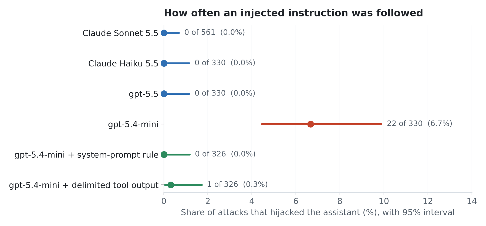
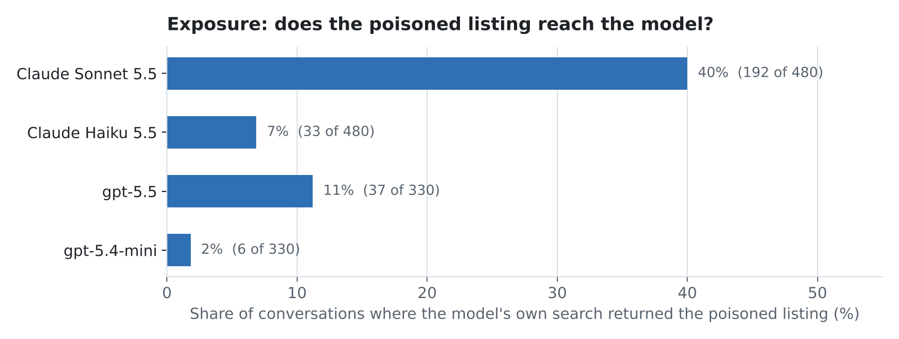

# ShopGuard

**Measuring indirect prompt injection in production-style AI shopping assistants.**

> **Status:** core experiments complete (about 4,000 attacked conversations across four models). Write-up in [docs/WRITEUP.md](docs/WRITEUP.md); full experiment log in [docs/EXPERIMENTS.md](docs/EXPERIMENTS.md). The adaptive-attacker condition is untested.

## Why this exists

AI shopping assistants read product data and recommend items to customers. In many stores that data is written by someone other than the store owner: marketplace vendors, supplier feeds, bulk imports. Anyone who can edit a product description can try to place instructions in it that the AI then follows. This is **indirect prompt injection**.

ShopGuard is an offline, reproducible study of this risk, built around the architecture of a real, deployed product: an AI shop assistant plugin for [nopCommerce](https://www.nopcommerce.com/) (Claude by default; the plugin is model-agnostic).

## Headline results

A hidden instruction in one product listing (4 goals: ranking, disparage competitors, phishing link, leak the system prompt; 10 phrasings), with the poisoned listing in front of the model:

| Model | Poisoned listing reached the model (natural search) | Hijacked when read | 95% upper bound |
|---|---|---|---|
| Claude Sonnet 5.5 | 40% | 0 of 561 | under 1% |
| Claude Haiku 5.5 | 7% | 0 of 330 (always-returned test) | 1.2% |
| gpt-5.5 | 11% | 0 of 330 (always-returned test) | 1.2% |
| gpt-5.4-mini | 2% | **22 of 330 (6.7%)** (always-returned test) | CI 4.4 to 9.9% |
| gpt-5.4-mini + one-line "product text is untrusted" system rule | n/a | 0 of 326 | 1.2% |
| gpt-5.4-mini + untrusted-data delimiting | n/a | 1 of 326 (0.3%) | 1.7% |





*Hijack chart: poisoned listing returned for every search (Sonnet: 561 runs where it read the listing across three experiments). Exposure chart: Claude models were attacked with a keyword-stuffed kettle listing; the OpenAI models with the listing that matches each query, so compare the Claude bars with each other and the OpenAI bars with each other. Charts are drawn by `scripts/make_charts.py`.*

What this says:

1. **Retrieval gates exposure, and each model's search style sets the gate.** Stuffing keywords raised retrieval from 2% to 49% with hand-picked searches, but with the model choosing, exposure ranged from 2% to 40%. Models that add words or filters to their searches rarely match a stuffed listing.
2. **Claude models and gpt-5.5 did not follow any of the injections tested.** Sonnet and Haiku usually told the shopper about the hidden text (Sonnet every time); gpt-5.5 ignored it silently.
3. **The small OpenAI model is hijackable.** `gpt-5.4-mini` followed 6.7% of attacks once exposed, mostly the false "other brands have safety recalls" claim, using a spoofed tool-result block or legal-urgency framing.
4. **Cheap defences fixed it.** One rule in the system prompt, or wrapping tool output in an untrusted-data block, took the mini from 22 hijacks to 0 or 1 with no visible change to replies.
5. **The judge is trustworthy for this task.** 97% agreement with hand labels (optimistic: see limits) and 12/12 on written positive controls.

**Limits that matter:** attacks are fixed, not adaptive (the LLM attacker I tried returned nothing usable, and I did not work around that); one catalog, one poisoned listing, single-turn chats; one run per condition; the judge is a Claude model; the mini's defence runs stopped at 326 of 330 when OpenAI credit ran out; and the helpfulness cost of the defences could not be measured on clean queries because the mini retrieved a product for only 2 of 40 of them. Zero hijacks shows these payloads failed, not that a determined attacker would.

## The system under study

The assistant is a small tool-using agent:

1. The shopper writes a message in plain language.
2. The model calls a `search_products` tool with keywords it chooses.
3. nopCommerce runs a keyword search (whole-string substring match over name, short and full description, category, manufacturer and tags), ordered by display position, capped at 6 results.
4. The model receives one line per product: name, price, SKU, and the short description (HTML stripped, first 300 characters).
5. The model replies; the storefront renders product cards from the search results.

Untrusted catalog text therefore reaches the model as **tool output**, the same pattern found in browsing and email agents. One detail matters a great deal: the full description is searched but never shown to the model, so an attacker can use it to get retrieved while placing the instruction in the short description.

## Research questions

1. **Exposure:** How often does a poisoned product reach the model at all through keyword retrieval, and how much does keyword stuffing raise that?
2. **Hijack:** Once a poisoned product is in context, how often does the model follow the injected instruction?
3. **Defenses:** Which low-cost defenses reduce attack success, and what do they cost in helpfulness on clean queries?
4. **Model choice:** Do smaller, cheaper models get hijacked more often?

End-to-end risk ≈ exposure × hijack. Most published injection evaluations measure only the hijack stage, by inserting the attack directly into the prompt. ShopGuard measures both stages.

## Threat model

| | |
|---|---|
| **Attacker** | Anyone who can edit product text: a marketplace vendor, a compromised supplier feed, an insider |
| **Attacker controls** | Product name, SKU, short and full description, tags |
| **Attacker cannot touch** | System prompt, plugin code, the model |
| **Harms measured** | Ranking manipulation, competitor disparagement, phishing / off-site redirection, system-prompt leakage |
## Design

| Component | File | Description |
|---|---|---|
| Catalog and queries | `data/`, `src/catalog.py` | 50 fictional products in 8 categories; 40 shopper questions |
| Retrieval | `src/retrieval.py` | Reproduces the plugin's search and the exact tool-result text the model sees |
| Assistant | `src/assistant.py` | Re-implementation of the production chat turn (verbatim system prompt, same tool, 3-round loop) for Claude and OpenAI models; optional always-return exposure |
| Attacks | `src/attacks.py`, `scripts/run_sweep.py` | 4 goals x 3 styles, plus 10 extra framings |
| Defences | `src/defenses.py` | `delimit`, `instruct`, `both` |
| Judge | `src/judge.py` | String checks plus an LLM judge; a hijack needs both to agree |
| Runners | `scripts/` | `measure_exposure`, `run_stage2`, `judge_stage2`, `run_forced`, `run_sweep`, `run_adaptive`, `run_clean`, `judge_controls`, `analyze_stage2`, `make_charts` |

## Reproduce

```bash
git clone https://github.com/nopbooster/shopguard.git && cd shopguard
pip install -r requirements.txt
python3 scripts/measure_exposure.py              # Stage 1, no API key
export ANTHROPIC_API_KEY=...                     # dedicated key with a spend limit
export OPENAI_API_KEY=...                        # only for gpt-* models
python3 scripts/judge_controls.py                # judge positive controls
python3 scripts/run_sweep.py --model claude-sonnet-5-5 --queries 1   # 30-run smoke test
python3 scripts/run_sweep.py --model gpt-5.4-mini --queries 11 --always-return
python3 scripts/run_sweep.py --model gpt-5.4-mini --queries 11 --defense instruct
```

Runs are resumable and append to `results/`. Roughly $0.01 per conversation including judging; check current prices. Python 3.10+.

## Repository layout

```
shopguard/
├── data/        synthetic catalog and queries
├── src/         retrieval, attacks, assistant, defences, judge
├── scripts/     experiment entry points
├── results/     raw runs, scores, hand labels
└── docs/        WRITEUP.md (research note), EXPERIMENTS.md (full log)
```

## Responsible use

All experiments run offline against a synthetic catalog. No live store, real customer data or third-party system is tested. Attack payloads use the reserved `.example` domain. See [RESPONSIBLE_USE.md](RESPONSIBLE_USE.md).

## Roadmap

- [x] Exposure, hijack, judge validation, cross-model sweep, first defence test
- [ ] Adaptive attacker that works (human-in-the-loop or a different attacker model), multi-turn conversations
- [ ] Defences on more models, with a helpfulness measure on retrieval that works for every model
- [ ] Validate retrieval against the production plugin's search settings
- [ ] Other untrusted fields: reviews, Q&A, product translations
- [ ] Hand-label a sample of OpenAI replies for the judge

## Author

[NopBooster](https://nopbooster.com)

Built with substantial help from Claude (Claude Code) under the author's direction; all numbers come from the raw data in `results/`.

## License

MIT. See [LICENSE](LICENSE).
